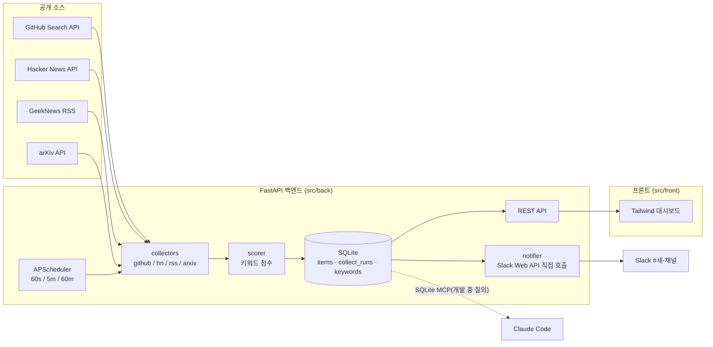

# 개인과제 ③ 고도화 계획 — **AI Radar** (연구·AI 트렌드 60초 레이더)

> **행사**: 동국대 IT 오프워크숍 · 2026-11-07(토) 09:00–18:00 · 학술관 291호
> **과제 규격**: 클로드코드 + FastAPI 백엔드 + **1분 자동 수집**
> **근거 자료**: 16주차 강의안 PDF 16종 · `프롬프트.txt` · 6장 `myCode/myOmc` 예제 · 대표님 PC 환경 점검(2026-11-06 19:45) · 데이터 소스 실측(같은 시각)
> **표기**: 강의안 근거는 `(16장 p12)` 식으로 표시. "추정"은 슬라이드에서 읽어낸 해석입니다.

---

## 0. 한눈에 보기

| 항목 | 내용 |
|---|---|
| **프로젝트명** | `myAIRadar` (AI Radar) |
| **한 줄 정의** | GitHub·Hacker News·GeekNews·arXiv의 *AI 에이전트/교육* 동향을 **60초마다** 자동 수집·점수화해 대시보드와 Slack으로 알려주는 개인 레이더 |
| **왜 이것인가** | ① 과제 규격(FastAPI+1분 수집)에 정확히 맞음 ② 6주 워크숍 2차시 "연구 동향 모니터링" 시연물이 됨 ③ AI 크래프터 블로그 글감 공급 ④ **공개 데이터만** 사용(기밀·개인정보 이슈 없음) |
| **하지 않는 것** | 로그인 필요 사이트 크롤링, 학교 내부 공지/규정 수집, 유료 LLM API 호출 |
| **작업 경로** | `C:\AI-myAIRadar` ← **영문 경로 필수**(바탕화면 한글 경로는 깨짐: 14장 p19, 15장 p7) |
| **서버 포트** | `8020` (myCash의 8010과 충돌 방지) |

### 오늘 18:00의 완성 기준 (Definition of Done)

- [ ] `uvicorn src.back.main:app --port 8020` 한 줄로 기동, 브라우저에서 대시보드 표시
- [ ] **60초마다** 자동 수집되어 DB 건수가 늘어남 (신규 0건이어도 *수집 성공 기록*이 남음)
- [ ] 소스 2개 이상(GitHub + Hacker News), 키워드 점수화, 중복 제거
- [ ] 네트워크 오류를 주입해도 서버가 죽지 않고 **로그 + 화면 경고**로 표시 (자가진단)
- [ ] `pytest` 통과 + GitHub push 완료
- [ ] 5분 데모 가능 (9장 시나리오) · 강의 3계명 3/3 (시스템 설계 · 자연어 개발 · 24시간 모니터링)

---

## 1. 분석 ① — 대표님 기준 출발점

| 구분 | 현황 | 이 과제에 주는 시사점 |
|---|---|---|
| 배경 | 홍익대 컴퓨터공학 학사 + 행정학 박사, 대학 교직원·강사 | 코드를 읽고 검증할 수 있음 → 공통과제 ①(환경 구축)은 효용 낮음, **개인과제 ③이 정답** |
| 이미 만든 자산 | `myCash`(plan/dev/design/build 4-에이전트 + FastAPI), 유튜브 분석 스킬, Hermes + Slack 연결 | `.claude/agents`·`commands`·`skills`를 **그대로 재사용** |
| 사업 연결 | 6주 워크숍 2차시(연구 동향·모닝 뉴스레터), 3차시(arXiv), 블로그 AI 크래프터 | 산출물이 *강의 시연 + 콘텐츠 공급*으로 바로 이어짐 |
| 원칙 | 최소 비용 · 최고 효율(0원) | 유료 API 없이 **공개 API + 규칙 기반 점수화** |
| 제약 | 8시간, 토큰 비용, 개인정보·기밀 제외 | 범위 컷라인을 시간표에 박아둠(8장) |

### 환경 점검 결과 (2026-11-06 19:45, 이 PC)

| 항목 | 상태 | 조치 |
|---|---|---|
| Python 3.12.10 · Node 24.14 · git 2.54 · uv 0.12 | ✅ | 없음 |
| FastAPI 0.136 · uvicorn 0.48 · httpx 0.28 | ✅ | 없음 |
| VS Code 한국어 팩 · `anthropic.claude-code` 확장 | ✅ | 없음 |
| **`claude` 명령(터미널)** | ❌ PATH에 없음 | `npm install -g @anthropic-ai/claude-code` 후 `claude` 로그인 (2장 슬라이드 p8의 `@anthopic-ai`는 **오타**, 13장·16장 표기가 맞음) |
| `apscheduler` · `feedparser` | ❌ 미설치 | `pip install apscheduler python-dotenv pytest` (feedparser는 선택) |
| `gh` (GitHub CLI) | ❌ | 불필요 (git + 웹으로 충분) |

> [!WARNING]
> Claude Code는 **Claude 계정(요금제) 로그인**이 필요합니다. 내일 현장에서 처음 막히기 쉬운 지점이므로 오늘 밤에 로그인까지 끝내 두세요.

---

## 2. 분석 ② — 강사·강의 설계의 특성

### 2-1. 강사가 가르치는 방식 (슬라이드에서 읽은 것)

- **결과물 중심**: 모든 장 표지가 "*답을 받는 도구에서, 결과물을 만드는 도구로*", 매 장 끝에 **"내 업무 1건"** 산출.
- **3단 반복 구조**: ① 앞 시연 **그대로** → ② **문장을 바꿔** 보기 → ③ **내 자료로** 만들기 (매 장 "많이 다뤄보십시오" 슬라이드).
- **프롬프트 설계 4요소**: *역할과 맥락 · 명확한 목표와 기능 · 제약조건과 기술스택 · 기대하는 출력* (16장 p5 Step 2).
- **안전 우선**: Plan 모드 → 검토 → 실행, **"백업은 기본"**(git commit 후 작업), Diff를 눈으로 훑기, 권한 설정은 "나를 지키는 방패" (9장 p18).
- **컨텍스트 위생**: `/context` 80% 넘으면 느려짐, `/clear` + **요약 바통터치**, 모델 체급 분리(haiku/sonnet/opus) (2장 p19–21, 11장).
- **"프롬프트를 잘 쓰는 것이 기술"**, 결과가 아쉬워도 괜찮으니 *여러 번 반복* (모든 장 공통).

### 2-2. 16장에서 선언한 3계명 — 내일의 *암묵적 평가 기준* (추정)

| # | 3계명 | 내 프로젝트에서 보여줄 증거 |
|---|---|---|
| 1 | **시스템 설계** | `CLAUDE.md` + `.claude/rules` + `docs/PLAN.md` + 서브에이전트 4역 |
| 2 | **자연어를 통한 개발** | 코드를 직접 치지 않고 7단계 프롬프트로 구현 (커밋 로그가 증거) |
| 3 | **온라인상에서 24시간 모니터링** | 60초 스케줄러 + `collect_runs` 로그 + `/api/health` + 자가진단 |

### 2-3. 16주차 → 내일 쓰는 스킬 맵

| 장 | 핵심 스킬 | 내일 어디에 쓰나 |
|---|---|---|
| 1 | AI 코딩 에이전트의 한계: *"실행하고 검증하는 태도"* | 모든 결과를 **직접 실행·확인** 후 커밋 |
| 2 | `/init`, `/model`, `/context`, `/clear`, Shift+Tab | 세션 운영 루틴(6-5) |
| 3·4 | 폴더·`/init`, 구조→함수→흐름 분석 → `*_analyze.md` | 완성 후 `docs/radar_analyze.md` 생성 |
| 5 | 역할+요구+**제약(내장 라이브러리, 용량 제한 등)**+출력 | 프롬프트에 *제약*을 반드시 명시 |
| 6·8 | plan/dev/design/build 에이전트, `/develop` 파이프라인 | `myCash/.claude` 복사 재사용 |
| 7 | 디버깅 4단계: **로그 추가 → 원인 설명(수정 금지) → 수정 → 재검증/영향 확인** | 7단계 Step 7 매크로 |
| 9 | Plan 모드, `/permissions`, `git add/commit/reset` 백업 | 단계마다 커밋 체크포인트 |
| 10 | `CLAUDE.md`(200줄 이내) + `src/back`·`src/front` 규칙 | 6-2 초안 |
| 11 | 컨텍스트·토큰, 요약 바통터치 | Step 전환마다 `/clear` + 3줄 요약 |
| 12 | `.claude/rules`·`.claude/skills`, 커스텀 명령, OMC `/autopilot` | `/digest` 스킬(7장 Step 5), 남으면 `/autopilot` |
| 13 | git push, Codespace(샌드박스), **push 안 하면 작업 소실** | 점심·종료 전 push |
| 14·15 | MCP(`.claude.json`), Slack/GitHub/Filesystem/SQLite MCP, 설정 후 **Claude 완전 재시작** | SQLite MCP로 DB 질의, Slack MCP로 개발 중 테스트 |
| 16 | **NoteAI 7단계**(준비→기획→개발→검증→다중MCP→모니터링→디버깅), `/mycode`, Render 배포, `claude --remote-control` | 내 프로젝트의 **뼈대 그대로** |

### 2-4. 강의안에 숨은 함정·힌트 (내일 시간 절약 포인트)

1. **한글 경로 → `C:\AI-...`** 로 작업 (14장 p19, 15장 p7).
2. GitHub 새 저장소는 **README / .gitignore / license 체크 금지** — 로컬과 충돌 (16장 p11).
3. `.claude/agents/mycode.md`는 **슬래시 명령으로 인식 안 됨** → `.claude/commands/`로 이동해야 `/mycode` 동작 (16장 p7).
4. 16장 p12에 *"API 문제를 미연에 방지하는 프롬프트가 숨어 있다"* → ① 해당 MCP가 없으면 **표준 라이브러리 대체 구현** ② 기동 전에 **Import 에러/오타 선수정**. → 내 프롬프트에도 그대로 넣습니다.
5. Render 배포(선택): `requirements.txt`는 최소화, `torch/transformers` 제외, **`==` 고정 금지**, 파일은 `backend/` 내부 (16장 p17).
6. Codespace는 **push 안 하면 샌드박스 작업이 날아감** (13장 p19).
7. MCP 설정 후에는 **Claude를 작업관리자에서 완전 종료 후 재시작** (14장 p18).
8. ⚠️ **14장 슬라이드(p11·p17)에 강사의 Slack 토큰이 노출**되어 있음 → 절대 사용하지 말고 **본인 토큰을 `.env`로만** 사용.

---

## 3. 프로젝트 선정 — 후보 비교

기준: 각 1~5점 (대표님 사업 관점의 주관 평가)

| 후보 | 과제 규격 | 1분 수집이 *눈에 보임* | 8시간 내 완성 | 사업 재활용 | 공개 데이터만 | 데모 임팩트 | **합계** |
|---|:-:|:-:|:-:|:-:|:-:|:-:|:-:|
| **A. AI Radar (AI·교육 동향)** | 5 | 5 | 4 | 5 | 5 | 4 | **28** |
| C. 블로그 글감 수집→초안 | 4 | 4 | 4 | 4 | 5 | 3 | 24 |
| D. 날씨/기상청 대시보드 | 5 | 5 | 4 | 1 | 5 | 3 | 23 |
| B. 학교 공지·규정 모니터→Slack | 5 | 2 | 3 | 4 | 3 | 3 | 20 |

- **D는 공통과제 ②와 중복**이고 사업 연결이 약함. **B는 공지가 하루 몇 건**이라 1분 수집이 안 보이고, 내부 규정은 보안·약관 이슈.
- **C는 A의 부분집합** → A의 `/digest` 스킬로 흡수.
- 공통과제 ②(SQLite MCP · Slack MCP)는 **A 안에서 함께 해결**합니다(8·7장).

### "1분 수집이 눈에 보이는가" — 실측 근거 (2026-11-06 19:45–19:50, 이 PC)

| 소스 | 실측 결과 | 설계 반영 |
|---|---|---|
| Hacker News `newstories` | 500건이 **약 14.7시간** 분량 → **≈34건/시간(0.6건/분)**, 제목이 AI 관련인 비율 **≈23%**(표본 60건) | 키워드로 *거르지 말고 전부 저장*, 점수로 구분 (거르면 대부분의 분에 0건) |
| GitHub Search API (`topic:… stars:>50`, `sort=updated`) | 토큰 사용 시 **한도 30회/분**, 상위 20개가 **모두 최근 10분 이내 push**(mcp는 2분 이내) | **⚡ 빠른 레인의 주력 소스** — 매분 새 활동이 보임 |
| GitHub Search (무인증) | 한도 **10회/분**, 측정 직전에 이미 **남은 횟수 3** (공유 IP) | `.env`의 GitHub 토큰 사용 필수 |
| GeekNews RSS | 20건, `Last-Modified` 헤더 지원 | 5분 주기 + 조건부 GET |
| arXiv API | 정상 응답 | 하루 단위로 갱신 → **60분 주기 느린 레인** (요청 간 3초 이상 간격 권장) |

> [!NOTE]
> 만약 arXiv만으로 "1분 수집"을 시연하면 대부분의 분에 새 데이터가 없어 **데모가 죽습니다.** 그래서 *빠른 레인(GitHub·HN) + 느린 레인(GeekNews·arXiv)* 의 **2-레인 수집**으로 설계합니다.

---

## 4. 제품 정의

### 사용자 스토리

- 강사로서, 오늘 올라온 *AI 에이전트·교육* 동향을 한 화면에서 보고 **강의 소재**로 쓰고 싶다.
- 블로거로서, 24시간 분량을 요약한 **마크다운 브리핑**을 받아 AI 크래프터 글감으로 쓰고 싶다.
- 운영자로서, 수집이 **살아있는지·실패했는지** 한눈에 알고 싶다.

### 기능 우선순위

| 구분 | 기능 |
|---|---|
| **Must** (M1~M3) | SQLite 저장·중복 제거 · GitHub/HN 수집기 · 60초 스케줄러 · `collect_runs` 로그 · REST API · Tailwind 대시보드(피드·카운트다운·통계·로그) · pytest · GitHub push |
| **Should** | GeekNews·arXiv 레인 · 키워드 관리 API · Slack **5분 요약 알림** · `/api/health` 자가진단(연속 3회 실패 시 소스 일시중지) · SQLite MCP 질의 |
| **Could** | `/digest` 스킬(블로그 브리핑) · Render 배포 · `claude --remote-control`(폰으로 모니터링) · OMC `/autopilot` 정리 · 다크모드 |

---

## 5. 아키텍처



> [!IMPORTANT]
> **MCP는 'AI가 일할 때'의 도구, 스케줄러는 '서버가 돌 때'의 코드**입니다. Slack 알림은 FastAPI가 **Slack Web API를 직접 호출**(httpx)하고, Slack MCP·SQLite MCP는 **개발·점검 중 Claude 세션**에서만 씁니다. (서버가 Claude 세션에 의존하면 24시간 모니터링이 성립하지 않음)

### 2-레인 수집 설계

| 레인 | 소스 | 주기 | 방식 |
|---|---|---|---|
| ⚡ 빠름 | GitHub 레포 활동 | **60초** | 토픽 4개(`ai-agent`·`mcp`·`claude-code`·`llm`) × `stars:>50` × `sort=updated` → 분당 4회(한도 30회) |
| ⚡ 빠름 | Hacker News 신규글 | **60초** | `newstories` 목록 − 이미 본 id → **신규만** item 조회(최대 30건/회, 동시 5) |
| 🐢 보통 | GeekNews RSS | 5분 | `If-Modified-Since` 조건부 GET |
| 🐌 느림 | arXiv `cs.AI·cs.CL·cs.CY` | 60분 | 요청 간 3초 이상, 최신순 |

공통 규칙: ① 타임아웃 10초 · 재시도 2회(지수 백오프) ② `User-Agent: AIRadar/0.1 (education)` ③ **`max_instances=1`, `coalesce=True`**(이전 실행이 안 끝나면 겹치지 않음) ④ 실패해도 예외를 삼키지 않고 `collect_runs`에 기록 ⑤ **신규 0건이어도 `status=ok` 기록(heartbeat)**.

### 데이터 모델

```sql
CREATE TABLE IF NOT EXISTS items (
  id            INTEGER PRIMARY KEY AUTOINCREMENT,
  source        TEXT NOT NULL,          -- github | hn | geeknews | arxiv
  source_id     TEXT NOT NULL,          -- 레포 full_name / HN id / 기사 URL / arXiv id
  title         TEXT NOT NULL,
  url           TEXT,
  summary       TEXT,
  author        TEXT,
  stars         INTEGER DEFAULT 0,      -- github 전용
  published_at  TEXT,                   -- ISO8601 UTC (github은 pushed_at)
  first_seen_at TEXT NOT NULL,
  last_seen_at  TEXT NOT NULL,
  score         REAL DEFAULT 0,
  tags          TEXT DEFAULT '',        -- 쉼표 구분
  UNIQUE(source, source_id)             -- 중복 제거의 핵심
);
CREATE TABLE IF NOT EXISTS collect_runs (
  id          INTEGER PRIMARY KEY AUTOINCREMENT,
  source      TEXT NOT NULL,
  started_at  TEXT NOT NULL,
  duration_ms INTEGER,
  fetched     INTEGER DEFAULT 0,
  inserted    INTEGER DEFAULT 0,        -- 신규 건수
  status      TEXT NOT NULL,            -- ok | error | paused
  error       TEXT
);
CREATE TABLE IF NOT EXISTS keywords (
  word   TEXT PRIMARY KEY,
  weight REAL DEFAULT 1.0
);
```

### 점수화 (LLM 비용 0원, 설명 가능)

`score = Σ(키워드 가중치 × 매칭수, 제목×2 · 요약×1) + log10(stars+1) × 0.5` 에 `0.5^(경과시간/6h)` 감쇠.
기본 키워드: `agent, 에이전트, claude, codex, mcp, vibe coding, 바이브 코딩, 교육, education, llm, rag, 자동화`.

### API

| 메서드 | 경로 | 설명 |
|---|---|---|
| GET | `/api/health` | 서버·스케줄러 상태, 마지막 수집 시각, 소스별 연속 실패 수 |
| GET | `/api/items?source=&q=&min_score=&limit=` | 피드 |
| GET | `/api/stats` | 소스별 건수 · 최근 60분 수집 추이 · 성공률 |
| GET | `/api/runs?limit=50` | 수집 로그 |
| POST | `/api/collect/run?source=` | 수동 수집(시연·디버깅) |
| GET·POST | `/api/keywords` | 키워드 조회·추가 |
| POST | `/api/notify/test` | Slack 테스트 메시지 |
| GET | `/api/export/digest.md?hours=24` | 마크다운 브리핑 |

### 대시보드 구성

상단 **상태 카드 4개**(수집 상태 🟢/🔴 · *다음 수집까지 NN초* · 오늘 신규 건수 · 성공률) → **실시간 피드**(소스 배지·점수·상대시간) → 소스별/분당 추이 차트 → **수집 로그 표**(실패 행 빨간색). 5초마다 `/api/stats`·`/api/items` 폴링.

---

## 6. Claude Code 운영 설계 (강의안 스킬 총동원)

### 6-1. 프로젝트 구조

```text
C:\AI-myAIRadar\
├─ CLAUDE.md                      # 10장: 200줄 이내
├─ .env / .env.example            # 비밀값 (커밋 금지)
├─ .claude\
│  ├─ agents\   plan.md dev.md design.md build.md      # myCash에서 복사 (6·8장)
│  ├─ commands\ plan.md dev.md design.md build.md      # ← 16장 p7: commands에 있어야 /명령 동작
│  ├─ rules\    architecture.md  code-standards.md     # 12장 p9·11
│  └─ skills\   make-api-doc.md  digest.md             # 12장
├─ src\back\   main.py scheduler.py db.py models.py scorer.py notifier.py routes.py
│              collectors\ base.py github.py hn.py rss.py arxiv.py
├─ src\front\  index.html app.js
├─ docs\       PLAN.md  API.md  radar_analyze.md
├─ tests\      test_db.py test_collectors.py test_api.py
└─ requirements.txt  README.md  .gitignore
```

### 6-2. `CLAUDE.md` 초안 (붙여넣기용)

```markdown
# AI Radar (myAIRadar)

## 목적
GitHub·Hacker News·GeekNews·arXiv의 AI 에이전트/교육 동향을 60초마다 자동 수집·점수화하여
대시보드와 Slack으로 알려주는 개인용 레이더. 강의 소재와 블로그 글감 공급이 목적.

## 기술 스택
- Backend: Python 3.12, FastAPI, sqlite3(표준), APScheduler, httpx
- Frontend: HTML + Tailwind CSS(CDN) + Vanilla JS (빌드 도구 없음)
- 실행: `uvicorn src.back.main:app --reload --port 8020`
- 테스트: `pytest -q`

## 구조
- src/back/ 백엔드, src/back/collectors/ 소스별 수집기
- src/front/ 대시보드, docs/ 문서, tests/ 테스트

## 규칙 (필수)
1. 모든 주석·docstring·사용자 메시지는 한국어로 작성한다.
2. 비밀값은 .env 에서만 읽는다. 코드·로그·커밋에 절대 포함하지 않는다.
3. 수집기는 예외를 삼키지 말고 collect_runs 에 기록한다. 신규 0건이어도 status=ok 로 남긴다.
4. 외부 호출은 타임아웃 10초, 재시도 2회(지수 백오프), User-Agent 명시.
5. 스케줄러 작업은 max_instances=1, coalesce=True.
6. 코드 수정 후에는 pytest 와 서버 기동으로 직접 검증한다.
7. 큰 변경은 Plan 모드로 계획 → 승인 → 실행. 단계마다 git commit 으로 백업한다.

## 금지
- 개인정보·회사 기밀 수집, 로그인이 필요한 사이트 크롤링, 유료 API 호출
- 수집한 본문을 그대로 재게시 (링크 + 짧은 요약만)
```

### 6-3. 규칙 파일

- `.claude/rules/code-standards.md` — 한국어 주석, snake_case, 함수 docstring, 예외는 구체적 타입으로 처리 (12장 p11).
- `.claude/rules/architecture.md` — `src/back`·`src/front` 분리 강제, 수집기는 `collectors/base.py`의 `BaseCollector.collect()` 인터페이스를 구현 (12장 p9).

### 6-4. 에이전트 재사용

`myCash\.claude\agents`·`commands`·`skills`를 **오늘 밤 탐색기로** `C:\AI-myAIRadar\.claude\`에 복사(한글 경로라 프롬프트로 복사 금지). 내일은 역할만 바꿉니다.

| 명령 | 역할 | 내일 용도 |
|---|---|---|
| `/plan` | 기획 | `docs/PLAN.md` |
| `/dev` | 백엔드 | DB·수집기·스케줄러·API |
| `/design` | UI | Tailwind 대시보드 |
| `/build` | 총괄 | 통합 점검 1회 |

### 6-5. 모델·컨텍스트 전략 (토큰 절약, 2장·11장·12장)

| 상황 | 모델 | 이유 |
|---|---|---|
| 구조 설계·플랜 | `/model opus` | 깊은 추론 필요 — **이때만** |
| 구현·디버깅(기본) | `/model sonnet` | 실무 밸런스 |
| 이름 변경·주석·import 발췌 | `/model haiku` | 가볍고 빠름 |

**Step이 바뀔 때마다**: ① "지금까지 합의한 것을 3줄로 요약해줘" → ② 복사 → ③ `/clear` → ④ 요약 붙여넣기 (11장 p6·p12). `/context`가 **80%** 넘으면 즉시 실행.

---

## 7. 7단계 프롬프트 플레이북 (붙여넣기용)

> 16장 p5의 **7단계 구조**를 그대로 따릅니다. 각 단계 끝에 `git commit` 체크포인트. 모든 프롬프트는 *역할·목표·제약·출력* 4요소를 갖췄습니다.

### Step 1 — 준비 (09:00–09:40)

```text
C:\AI-myAIRadar 를 작업 폴더로 쓸 거야. 아래를 수행해줘.
1. src/back, src/back/collectors, src/front, docs, tests 폴더 생성
2. git init, .gitignore 생성(.env, __pycache__/, *.db, .venv/, .claude/settings.local.json)
3. .env.example 생성: GITHUB_TOKEN=, SLACK_BOT_TOKEN=, SLACK_CHANNEL_ID=
4. requirements.txt 생성: fastapi, uvicorn[standard], httpx, apscheduler, python-dotenv, pytest (버전은 고정하지 말고 하한만)
CLAUDE.md 는 /init 으로 만들 거니까 지금은 만들지 마.
```
→ `/init` → "CLAUDE.md 를 6-2의 내용으로 **교체**해줘" → "`.claude/rules/code-standards.md`와 `architecture.md`를 6-3 설명대로 만들어줘" → `git add . && git commit -m "chore: 프로젝트 준비"`

### Step 2 — 기획 (09:40–10:30) · *Shift+Tab → Plan 모드*

```text
[Plan Mode] 코드는 쓰지 말고 계획만 세워줘.
(역할과 맥락) 너는 시니어 백엔드 아키텍트야. 나는 대학에서 AI 에이전트 교육을 하는 강사이고, 공개된 AI 동향을 자동 수집해 강의 소재와 블로그 글감으로 쓰고 싶어.
(목표와 기능) AI Radar: 60초마다 GitHub(topic: ai-agent, mcp, claude-code, llm / stars>50 / 최근 갱신순)와 Hacker News 신규글을 수집해 SQLite에 저장하고 중복을 제거하며 키워드로 점수화한다. 대시보드에서 최신 피드, 소스별 건수, 수집 로그, 다음 수집까지 카운트다운을 본다. 수집 실패는 로그와 화면 경고로 남는다.
(제약과 기술스택) Python 3.12, FastAPI, sqlite3, APScheduler, httpx, Tailwind CDN. 로그인 필요 사이트·개인정보 수집 금지. 비밀값은 .env. 모든 주석은 한국어. 외부 호출 타임아웃 10초. 스케줄 작업은 겹쳐 실행되지 않게.
(기대 출력) docs/PLAN.md — 요구사항 표, 디렉토리 구조, DB 스키마, API 목록, 수집기 설계(주기·중복·오류 처리), 30분 단위 구현 체크리스트, 위험요소. 내가 승인하기 전에는 파일을 수정하지 마.
```
→ 계획을 읽고 **2번 이상 수정 요청**(9장 p10 "2번 파일은 건드리지 마" 식) → 승인 → `docs/PLAN.md` 저장 → 커밋.

### Step 3 — 개발 (10:30–14:00, M1 11:30 · M2 13:00)

**3-1 (M1) 데이터·수집·스케줄** — `/dev`
```text
docs/PLAN.md 를 기준으로 백엔드를 구현해줘.
1. db.py: 3개 테이블 생성(items·collect_runs·keywords), UNIQUE(source, source_id)로 중복 방지, 모든 쿼리는 파라미터 바인딩
2. collectors/base.py: BaseCollector 추상 클래스(collect() -> 수집 결과 요약)
3. collectors/github.py: Search API(topic별 stars:>50, sort=updated, per_page=20), .env 의 GITHUB_TOKEN 사용, 없으면 토픽 2개로 축소
4. collectors/hn.py: newstories 목록에서 이미 본 id 제외, 신규만 최대 30건 동시 5개로 조회
5. scheduler.py: APScheduler 60초 간격(max_instances=1, coalesce=True), 실행마다 collect_runs 기록(신규 0건이어도 ok)
6. main.py: 서버 기동 시 DB 초기화 + 스케줄러 시작, /api/health
기동 전에 import 에러·오타를 먼저 점검하고, 직접 서버를 띄워서 60초 뒤 collect_runs 가 2건 이상 쌓이는지 확인해줘.
```
✅ **M1 증거**: `/api/health`의 마지막 수집 시각이 매분 갱신 → 커밋 `feat: 60초 수집 파이프라인`.

**3-2 점수화·API** — `/dev`
```text
scorer.py 와 routes.py 를 추가해줘. 점수 공식은 docs/PLAN.md 를 따르고, /api/items, /api/stats, /api/runs, /api/collect/run, /api/keywords 를 구현해줘. 기본 키워드는 시드로 넣어줘. 각 엔드포인트의 요청·응답 예시를 docs/API.md 에 한국어로 정리해줘.
```

**3-3 (M2) 대시보드** — `/design`
```text
src/front/index.html 과 app.js 에 대시보드를 만들어줘. 깔끔하고 모던한 SaaS 대시보드, 플랫 디자인, 부드러운 그림자, Tailwind CSS(CDN), 모바일 반응형, 다크모드에서도 잘 보이게.
상단 상태 카드 4개(수집 상태 🟢/🔴, 다음 수집까지 NN초 카운트다운, 오늘 신규 건수, 성공률) → 실시간 피드(소스 배지·점수·상대시간) → 소스별 건수 막대 → 수집 로그 표(실패는 빨간색). 5초마다 API 를 폴링하고, API 실패 시 화면 상단에 한국어 경고 배너를 띄워줘. FastAPI 가 / 에서 이 파일을 서빙하게 해줘.
```
✅ **M2 증거**: 브라우저에서 *카운트다운이 0이 되면 숫자가 늘어남*.

### Step 4 — 검증 (14:00–15:00)

```text
현재 프로젝트의 디렉토리 구조와 데이터 흐름을 분석한 뒤 pytest 를 작성해줘.
- test_db: 같은 (source, source_id)를 두 번 넣어도 1건만 저장되는지
- test_collectors: httpx 를 모의(mock)하여 정상 응답 / 타임아웃 / 429 / 잘못된 JSON 에서 예외로 죽지 않고 collect_runs 에 error 가 기록되는지
- test_api: /api/health, /api/items 응답 형식
- test_scheduler: 이전 실행이 안 끝났을 때 겹쳐 실행되지 않는지(max_instances=1)
작성 후 pytest 를 직접 실행해서 결과를 보여주고, 실패하면 원인을 설명한 뒤 수정해줘.
```
→ 결과를 `docs/radar_analyze.md`로 저장시키면 4장 스킬(구조→함수→흐름 분석) 증거 확보.

### Step 5 — 다중 MCP·외부 연동 (15:00–16:00)

```text
[점검] 현재 세션에 연결된 MCP 목록과 상태를 알려줘. 연결이 안 된 MCP가 있으면 표준 라이브러리로 대체 가능한지도 판단해줘. 그리고 앱 구동을 막는 import 에러·문법 오류가 없는지 전체 검사해줘.
```
```text
notifier.py 를 만들어줘. Slack Web API(chat.postMessage)를 httpx 로 직접 호출하고, 토큰·채널은 .env 에서 읽어. 5분마다 "지난 5분 신규 항목 중 점수 상위 3개"를 한 건의 메시지로 요약해 보내줘(스팸 방지). 신규가 없으면 보내지 않아. /api/notify/test 로 즉시 테스트할 수 있게 해줘.
```
```text
(SQLite MCP 연결 후) radar.db 에서 지난 1시간 동안 소스별 신규 건수와 평균 점수를 표로 보여줘.
```
> ⏱ **MCP 연결에 막히면 5분 이상 쓰지 않고 건너뜁니다.** 핵심 요건(수집·FastAPI)이 아니라 *가산점*입니다.

### Step 6 — 24시간 모니터링 (16:00–16:40)

```text
24시간 무인 운영을 위한 자가진단을 추가해줘.
1. 소스별 연속 실패 3회 → 해당 소스를 10분간 paused 로 전환하고 collect_runs 에 기록, Slack 으로 경고 1건
2. 로그는 RotatingFileHandler(파일당 1MB, 3개)로 logs/radar.log 에 저장
3. 서버 재시작 후에도 마지막 수집 시각과 본 HN id 를 DB에서 복구
4. /api/health 에 소스별 상태(ok/paused)와 연속 실패 수 표시
네트워크를 끊었을 때와 복구했을 때의 동작을 직접 시뮬레이션해서 보여줘.
```

### Step 7 — 디버깅·배포 (16:40–17:30)

디버깅 매크로 (7장 p11–13 그대로):
```text
(1) 이 현상의 원인을 찾기 위해 관련 함수에 단계별 로그를 추가해줘.
(2) 로그를 보고 원인을 분석해줘 — 코드를 바로 고치지 말고, ① 어느 함수의 어느 부분이 문제인지 ② 왜 문제인지 먼저 설명해줘.
(3) 이해했어. 이제 수정해줘. 수정 후 ① 무엇을 어떻게 바꿨는지 ② 같은 시나리오로 다시 실행한 결과 ③ 다른 화면·기능에 미치는 영향을 알려줘.
```
마무리:
```text
README.md 에 설치·실행·.env 설정·테스트 방법을 한국어로 정리하고, 변경사항을 커밋한 뒤 GitHub 저장소(https://github.com/<내아이디>/myAIRadar)에 push 해줘. push 후 uvicorn 으로 서버를 띄워 브라우저에서 대시보드를 확인할 수 있게 해줘.
```

### 보너스 (시간이 남을 때)

`.claude/skills/digest.md` 생성 요청:
```text
.claude/skills/digest.md 스킬을 만들어줘. 절차: ① GET /api/export/digest.md?hours=24 호출 ② 점수 상위 10개 선정 ③ 항목마다 1~2문장 한국어 해설 ④ '오늘의 인사이트' 3줄 ⑤ docs/digest-YYYYMMDD.md 로 저장. 원문은 재게시하지 않고 링크와 짧은 요약만 쓴다. /digest 로 호출되게 commands 에도 등록해줘.
```
→ 유료 LLM API 없이 **Claude Code 자체가 요약 엔진**이 되는 구조(12장 skills 개념).

---

## 8. 시간표와 컷라인

> 강사 오리엔테이션이 있으면 Step 1–2를 압축합니다. **점심 전 push 필수**(13장).

| 시간 | 내용 | 체크포인트(증거) | 커밋 |
|---|---|---|---|
| 08:30–09:00 | 도착, 노트북·로그인·`claude` 동작 확인 | `claude` 실행 OK | — |
| 09:00–09:40 | Step 1 준비 | 폴더·규칙·CLAUDE.md | `chore: 준비` |
| 09:40–10:30 | Step 2 기획 (Plan 모드) | `docs/PLAN.md` 승인 | `docs: 기획` |
| 10:30–11:30 | Step 3-1 수집·스케줄러 | **M1: 매분 collect_runs 증가** | `feat: 수집 파이프라인` |
| 11:30–12:00 | Step 3-2 점수화·API | `/api/items` 응답 | `feat: API` |
| **12:00–13:00** | **점심 + git push** | GitHub에 코드 보임 | — |
| 13:00–14:00 | Step 3-3 대시보드 | **M2: 카운트다운 → 건수 증가** | `feat: 대시보드` |
| 14:00–15:00 | Step 4 검증 | pytest 통과, 오류 주입 | `test: 검증` |
| 15:00–16:00 | Step 5 Slack·SQLite MCP | 폰에 Slack 요약 도착 | `feat: 알림` |
| 16:00–16:40 | Step 6 자가진단 | 네트워크 차단→경고→복구 | `feat: 자가진단` |
| 16:40–17:30 | Step 7 디버깅·README·push | 최종 push | `docs: README` |
| 17:30–18:00 | 데모 리허설·체크리스트 | 3계명 3/3 | — |

### 컷라인 (뒤처졌을 때 무엇을 버릴까)

| 시점 | 상태 | 포기 순서 |
|---|---|---|
| 12:00 | M1 미달 | arXiv·GeekNews·점수화 정교화 → **GitHub 1소스 + 단순 저장**에 집중 |
| 15:00 | M2 미달 | 차트·다크모드 포기, 피드 + 상태카드만 |
| 16:00 | Slack/MCP 막힘 | **전부 건너뜀** (가산점 항목) |
| 어느 때든 | 막힘 15분 초과 | 강사/조교 호출 (아래 질문 목록 활용) |

> 원칙: **M1(60초 수집이 도는 서버) + M2(보이는 화면) + push** 가 되면 과제는 성공입니다. 나머지는 가산점입니다.

---

## 9. 데모 시나리오 (5분)와 현장 질문

### 데모 흐름

1. **(30초)** 문제: "AI 동향을 매일 손으로 찾던 시간을 0으로" — 6주 워크숍 2차시 연계 설명
2. **(60초)** 대시보드 열기 → 상태 카드 🟢, *카운트다운 00초 → 신규 건수 증가*를 **실시간으로 보여줌**
3. **(60초)** 오류 주입(와이파이 끄기/잘못된 토큰) → 🔴 경고 배너 + 수집 로그 빨간 행 → 복구되면 🟢
4. **(45초)** 폰에 도착한 **Slack 5분 요약** 보여주기
5. **(45초)** 커밋 로그 = 7단계 프롬프트 증거, `CLAUDE.md`·`rules`·`/plan` = 시스템 설계 증거
6. **(60초)** 확장: "이 구조에 키워드만 바꾸면 *행정 규정 변경 모니터*, *입시 뉴스 모니터*가 됩니다"

### 강사·조교에게 물어볼 질문

1. 백그라운드 스케줄은 APScheduler가 좋은지, `asyncio` 루프가 좋은지 권장 방식은?
2. 개인과제 **제출·발표 형식**(저장소 링크? 라이브 데모?)은?
3. Codespace에서 서버를 띄웠을 때 **포트 공개·장시간 유지**는 어떻게 하나?
4. Claude Code 계정·토큰 소진 시 **현장 대안**이 있는지?
5. (배포 관심 시) Render 무료 플랜에서 **60초 스케줄러가 잠들지 않게** 하려면?

---

## 10. 리스크와 대응

| 리스크 | 징후 | 대응 |
|---|---|---|
| `claude` 미설치·로그인 실패 | 터미널에서 명령 없음 | **오늘 밤** 설치·로그인 (11장 체크리스트) |
| 한글 경로 깨짐 | MCP·파일 경로 오류 | `C:\AI-myAIRadar` 고정 |
| GitHub 검색 한도 소진 | HTTP 403/429, `x-ratelimit-remaining: 0` | 토큰 사용, 분당 4회 유지, 429 시 백오프·`paused` |
| 포트 충돌·구버전 서버 잔류 | 수정이 반영 안 됨, 405 | 포트 8020, `--reload`, 기존 프로세스 종료 (myCash에서 겪은 문제) |
| 토큰 소진 | 응답 느림/중단 | haiku/sonnet 분리, Step마다 `/clear`+요약 |
| AI의 습관적 승인 | 의도치 않은 파일 수정 | **Diff 훑기**, Plan 모드, 커밋 백업, 필요 시 `git reset --hard HEAD` (9장) |
| 비밀값 유출 | `.env`가 커밋됨 | `.gitignore` 선작성, 커밋 전 `git status` 확인 |
| 약관·저작권 | 본문 무단 재게시 | 링크 + 짧은 요약만, User-Agent 명시, API 요청 간격 준수 |
| 시간 부족 | 12시에 M1 미달 | 8장 컷라인 |

> [!CAUTION]
> **이미 노출된 토큰**: 14장 슬라이드의 강사 Slack 토큰은 **사용 금지**. 그리고 이 대화·설정 과정에서 화면에 노출된 본인 토큰(Slack Bot/App, GitHub PAT, Tavily 키)은 **워크숍이 끝난 뒤 재발급**을 권장합니다. 내일은 `.env`에만 두고 프롬프트·커밋·스크린샷에 넣지 마세요.

---

## 11. 오늘 밤 체크리스트 (우선순위 순)

- [ ] **① `npm install -g @anthropic-ai/claude-code` → `claude` 실행 → 웹 로그인 승인** *(최우선)*
- [ ] ② Claude 계정 요금제/크레딧 확인 (토큰 소진 대비 haiku 기본)
- [ ] ③ `C:\AI-myAIRadar` 폴더 생성, `myCash\.claude` → `C:\AI-myAIRadar\.claude` 복사 (agents · commands · skills)
- [ ] ④ `pip install apscheduler python-dotenv pytest`
- [ ] ⑤ GitHub에 **빈 저장소 `myAIRadar`** 생성 (README/.gitignore/license **체크 금지**)
- [ ] ⑥ `.env` 준비: `GITHUB_TOKEN`, `SLACK_BOT_TOKEN`, `SLACK_CHANNEL_ID` (Slack 워크스페이스: `shinhan-uak9597`, 봇 `Hermes`가 채널에 초대되어 있어야 함)
- [ ] ⑦ 이 문서의 **6-2 CLAUDE.md**와 **7장 프롬프트**를 메모장/폰에 복사해 두기
- [ ] ⑧ 노트북 충전기·멀티탭, 주차(12시간 할인권 7,000원), 점심 제공, **학술관 291호**(같은 층 내 변경 가능)

> 원하시면 ③④⑤ 중 **자동화 가능한 부분(폴더 생성·`.claude` 복사·pip 설치·`.env.example`)** 은 제가 오늘 밤 미리 실행해 둘 수 있습니다. (`claude` 로그인과 GitHub 저장소 생성은 계정 로그인이 필요해 직접 하셔야 합니다.)

---

## 12. 워크숍 이후 — 사업 자산화

| 자산 | 활용 |
|---|---|
| 6주 워크숍 **2차시** "연구 동향 모니터링" | AI Radar를 *완성 시연물*로 사용, 수강생용 단순 버전(RSS 1개) 실습 |
| 블로그 *AI 크래프터* | `/digest` 결과를 글감으로 주 2~3회 발행 |
| Hermes | 수집 결과를 Hermes `cron`으로 아침 브리핑 → Slack/폰 전달 |
| 교재·출판 | "60초 레이더 만들기" 장으로 확장 (부크크 전자책) |
| 확장 | 키워드·소스 교체로 *행정 규정 변경*, *입시 뉴스*, *경쟁사 모니터* 레이더 (6대 사업 중 신한대 앱·마케팅 도구) |
